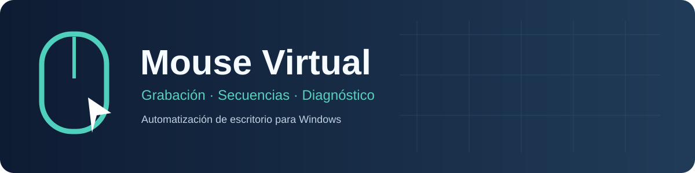
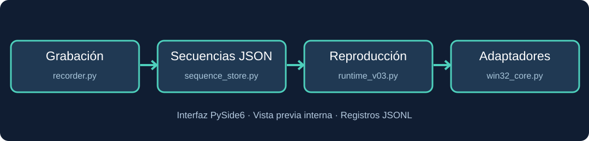

# Mouse Virtual

**Grabación, secuencias y automatización local de mouse en Windows.**

   

## ¿Qué es?

**Mouse Virtual** es una aplicación de escritorio para Windows que permite grabar clics, organizar secuencias con pausas, guardarlas localmente y reproducirlas con diferentes mecanismos de entrada. Incluye herramientas de simulación, vista previa del cursor, control de repeticiones y registros para diagnóstico.

El cursor virtual es una **representación visual**: no equivale a un segundo dispositivo físico ni garantiza compatibilidad con juegos.

## Funcionalidades

- **Clicker:** intervalo configurable, botones de mouse, clic simple/doble y número de repeticiones.
- **Grabador:** hook de Windows que registra los clics de la ventana destino y los intervalos entre acciones.
- **Secuencias:** editor y almacenamiento de pasos en JSON, con nombres y repeticiones finitas o continuas.
- **Reproductor:** ejecución cancelable, contador y seguimiento de acciones.
- **Mouse virtual visual:** indicador gráfico integrado, sin superposición global sobre las otras ventanas.
- **Coordenadas:** posiciones relativas a la ventana cliente y metadatos de geometría para grabaciones recientes.
- **Diagnóstico:** logs JSONL y prueba de recepción Win32 en ventana aislada.

## Arquitectura — Modular Single App

Una sola aplicación Windows, organizada en paquetes funcionales dentro de `src/mouse_virtual/`. **No es un monorepositorio**: las carpetas de pruebas, herramientas y documentación viven fuera del paquete distribuible.

| Carpeta | Responsabilidad |
| --- | --- |
| `src/mouse_virtual/app/` | Arranque, ventana Qt, navegación y composición |
| `src/mouse_virtual/modules/clicker/` | Clics temporizados |
| `src/mouse_virtual/modules/keyboard/` | Entrada de teclado |
| `src/mouse_virtual/modules/recording/` | Grabación y controles de captura |
| `src/mouse_virtual/modules/sequences/` | Modelos, persistencia y edición de secuencias |
| `src/mouse_virtual/modules/playback/` | Reproducción y diagnósticos |
| `src/mouse_virtual/modules/automation/` | Selección de ventanas y panel de automatización |
| `src/mouse_virtual/modules/virtual_cursor/` | Vista previa interna del cursor |
| `src/mouse_virtual/infrastructure/` | Adaptadores Win32, geometría, configuración y logs |
| `src/mouse_virtual/resources/` | Hoja de estilos Qt |
| `tests/` | Pruebas unitarias, de integración y GUI |
| `scripts/`, `packaging/`, `docs/` | Laboratorio, distribución y documentación |

El archivo `main.py` de la raíz es únicamente un lanzador de compatibilidad. Más información en [arquitectura y normas de dependencia](docs/architecture/README.md).

## Modos de entrada

| Modo | Qué hace | Restricciones |
| --- | --- | --- |
| **Simulación** | Recorre pasos y posiciones sin enviar clics | No interactúa con aplicaciones |
| **Win32 dirigido** | Envía mensajes de mouse a un HWND sin mover el cursor físico | Un mensaje enviado **no implica un clic recibido** |
| **Entrada global** | Emite entrada del mouse del sistema y puede mover el cursor físico | Puede interferir con el trabajo; requiere foco y confirmación |

La recepción por la aplicación destino siempre debe comprobarse por separado. El contador informa sobre acciones procesadas por el reproductor, no sobre acciones reconocidas por otro programa.

## Compatibilidad

- **Windows:** arquitectura centrada en Win32, probada principalmente en Windows 11; pensada para Windows 10/11 de 64 bits.
- **Ventanas clásicas:** mensajes Win32 aceptados por una ventana receptora de laboratorio: **18 de 18 eventos**.
- **Roblox:** **no se ha confirmado que procese clics en segundo plano**. Durante pruebas reales se emitieron mensajes sin reacción observable.
- **Otros motores de juego y aplicaciones con entrada exclusiva:** compatibilidad no confirmada.
- **Linux/macOS:** no compatibles con el adaptador actual.

La aplicación no implementa técnicas para eludir protecciones o controles de integridad de programas de terceros.

## Tecnologías

Python 3.12, PySide6/Qt, ctypes, Win32 API, JSON/JSONL, pytest y PyInstaller para generar distribuciones Windows.

## Instalación

Se requiere Windows, Python 3.12 y PowerShell.

~~~powershell
git clone https://github.com/JaimeArriagadaRosas/Mouse-Virtual.git
cd Mouse-Virtual
py -3.12 -m venv .venv
.\.venv\Scripts\python.exe -m pip install -r requirements.txt
.\.venv\Scripts\python.exe main.py
~~~

Después de configurar el entorno también puedes utilizar **run.bat**.

## Uso básico

1. Abre la pestaña **Automatización** y selecciona la ventana destino.
2. Inicia **Grabar (F9)** y realiza los clics de la secuencia en la ventana seleccionada.
3. Presiona **F9** para finalizar; F10 permite pausar o reanudar la grabación.
4. Guarda y selecciona tu secuencia; revisa sus pasos y coordenadas.
5. Ejecuta primero en **Simulación** y verifica que los pasos sean correctos.
6. Utiliza Win32 dirigido solamente con aplicaciones compatibles y comprueba la recepción real.
7. Para detener la reproducción utiliza el botón Detener o **F7**.

**Atajos:** F6 iniciar; F7 detener; F8 alternar reproducción; F9 grabar/finalizar; F10 pausa de grabación; Ctrl+Shift+F12 parada de emergencia. Algunos dependen del foco y de las restricciones de la aplicación destino.

## Almacenamiento

- Secuencias: %LOCALAPPDATA%\MouseVirtual\sequences
- Logs: %LOCALAPPDATA%\MouseVirtual\logs
- Configuración: %LOCALAPPDATA%\MouseVirtual\settings.json

Los archivos locales del usuario no se incluyen en este repositorio.

## Pruebas

Las pruebas están separadas en `tests/unit`, `tests/integration`, `tests/gui` y `tests/labs`; consulta la [guía de pruebas](docs/testing/README.md) para decidir dónde añadir cada escenario.

~~~powershell
.\.venv\Scripts\python.exe -m pytest -q tests
.\.venv\Scripts\python.exe scripts/input_receiver_lab.py
~~~

La batería de referencia del 30/10/2026 consta de **71 pruebas automatizadas aprobadas**. La prueba de recepción Win32 confirmó 18/18 mensajes en una ventana aislada; esto **no valida la entrada en Roblox**.

Prueba de interfaz aislada:

~~~powershell
$env:QT_QPA_PLATFORM = 'offscreen'
.\.venv\Scripts\python.exe scripts/gui_e2e_isolated.py
Remove-Item Env:QT_QPA_PLATFORM
~~~

## Compilación

PyInstaller es una dependencia de compilación opcional:

~~~powershell
.\.venv\Scripts\python.exe -m pip install pyinstaller
.\.venv\Scripts\python.exe -m PyInstaller --noconfirm packaging/MouseVirtual.spec
~~~

Los archivos generados quedan en **dist/MouseVirtual** y se excluyen de Git. La aplicación requiere la carpeta completa de distribución y no únicamente el ejecutable.

## Control de navegador para agentes (versión inicial)

El paquete incorpora un adaptador opcional de **Playwright/Chromium** que opera en una sesión separada del mouse y teclado del usuario. Puede descubrir campos mediante roles y etiquetas, escribir texto, activar botones y leer el resultado. Su primer escenario de integración utiliza una página local que busca «perritos», sin acceso al navegador personal.

Para instalar la dependencia opcional:

~~~powershell
.\.venv\Scripts\python.exe -m pip install -e ".[browser]"
.\.venv\Scripts\python.exe -m playwright install chromium
~~~

En un sitio de laboratorio con un campo de búsqueda accesible, se puede usar el CLI:

~~~powershell
.\.venv\Scripts\python.exe -m mouse_virtual.modules.agent_control.cli --url http://127.0.0.1:8000 --query perritos --allowed-host 127.0.0.1
~~~

**Importante:** la ejecución CLI sigue limitada a hosts permitidos; no implementa aún integración MCP, UI Automation de escritorio ni operación en cualquier navegador del usuario. No se incluye el entorno Playwright/Chromium en el ejecutable principal.

Se incorporó un cursor virtual SVG negro de elaboración propia; este cursor sigue siendo solo una indicación visual. Las mediciones de temporizador están en [el informe de rendimiento](docs/testing/performance.md).

## Estado del desarrollo

**Experimental.** Funcionales: captura, persistencia, interfaz, simulación y envío de mensajes Win32. Pendientes: calibración en diferentes configuraciones de monitores, pruebas adicionales de GUI y verificación de compatibilidad real con aplicaciones que utilizan entrada exclusiva.

Consulta el [documento de pendientes](docs/roadmap/README.md) para el estudio de Roblox y mejoras previstas. El proyecto **no** incluye ejecutables, archivos ni herramientas de ingeniería inversa de Roblox.

## Licencia y contribuciones

**Código fuente público con derechos reservados.** No es una licencia de software libre ni de código abierto bajo OSI. Consulta [LICENSE](LICENSE) para conocer los permisos limitados de evaluación y la necesidad de autorización para redistribuir o utilizar el proyecto comercialmente.

Las contribuciones mediante issues y pull requests son bienvenidas bajo las condiciones de [CONTRIBUTING.md](CONTRIBUTING.md). La titularidad original del proyecto corresponde a su autor y los colaboradores conservan su propia autoría según los términos descritos.

## Autor

[Jaime Arriagada Rosas](https://github.com/JaimeArriagadaRosas). Los SVG incluidos son recursos originales del proyecto.

